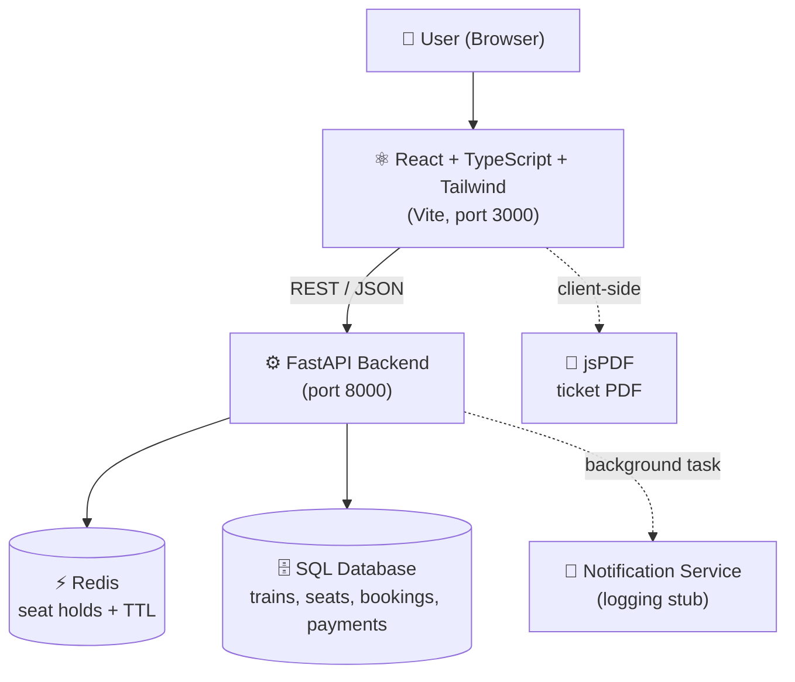
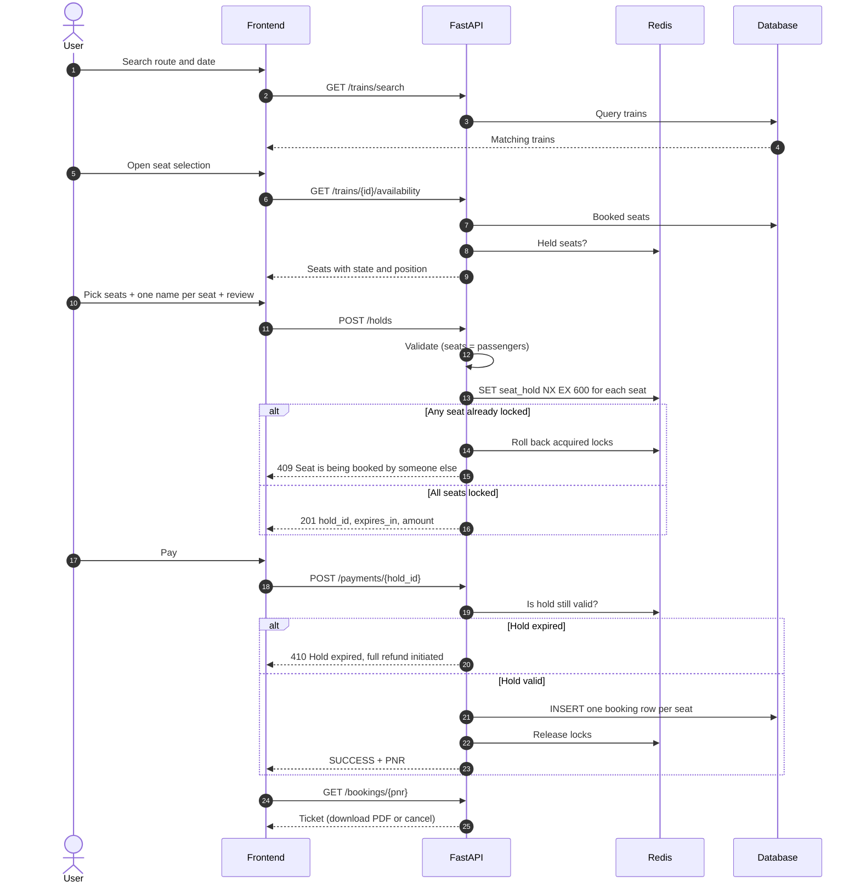
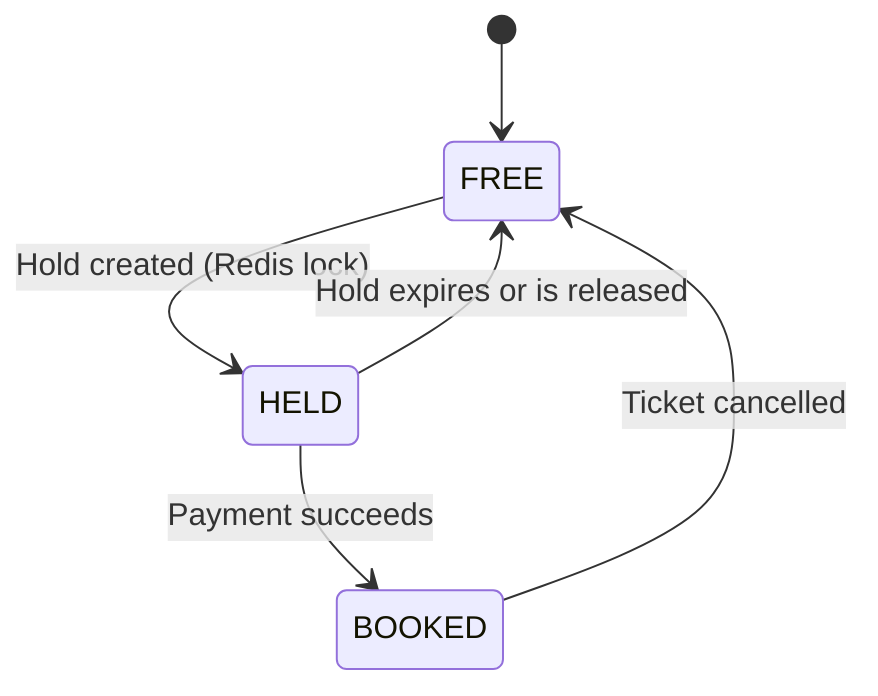
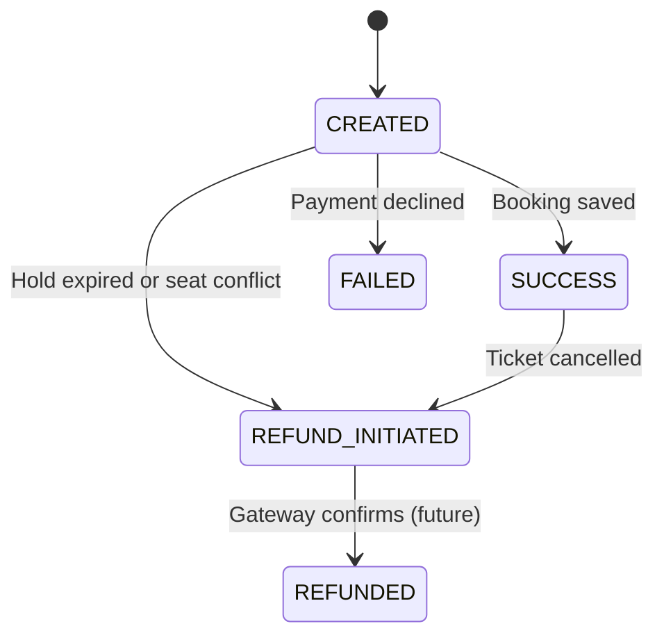
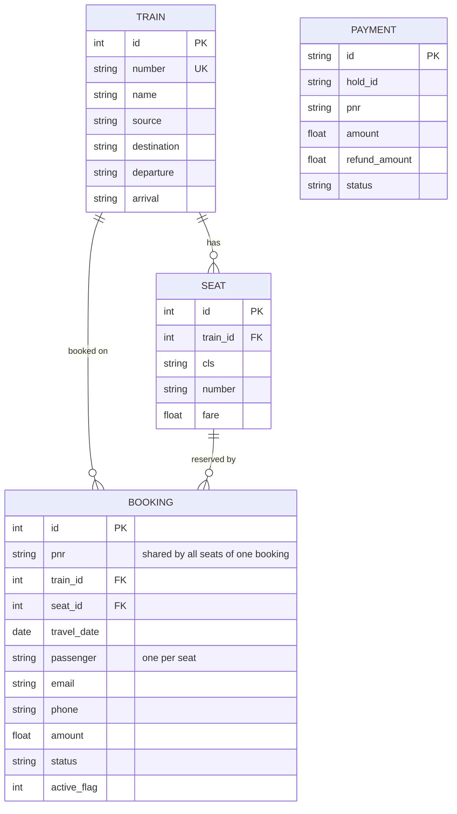

<div align="center">

<!-- 🖼️ Replace with your banner:  -->

# 🚆 RailEase

### _Book smarter. Travel easier._

**A modern, real-time train seat reservation system with race-condition-proof seat holds, multi-passenger bookings, dark mode, and downloadable PDF tickets.**

Seat hold in Redis (`SET seat_hold:{train}:{date}:{class}:{seat} <hold_id> NX EX 600`) -> payment -> DB booking + 10-digit PNR -> Redis key deleted.
<br/>

[](https://choosealicense.com/licenses/mit/)
[](#-roadmap--future-improvements)
[](https://github.com/sujalrajpoot/RailEase/stargazers)
[](https://github.com/sujalrajpoot/RailEase/network/members)
[](https://github.com/sujalrajpoot/RailEase/issues)
[](https://github.com/sujalrajpoot/RailEase/graphs/contributors)
[](#-roadmap--future-improvements)


[🚀 Quick Start](#%EF%B8%8F-installation--setup) · [✨ Features](#-features) · [🏗️ Architecture](#%EF%B8%8F-flow-architecture) · [📡 API](#-api-documentation) · [🤝 Contribute](#-contributing) · [🛣️ Roadmap](#%EF%B8%8F-roadmap--future-improvements)

</div>

---

## 📑 Table of Contents

<details>
<summary>Click to expand</summary>

- [📖 Overview](#-overview)
- [✨ Features](#-features)
- [🛠️ Tech Stack](#%EF%B8%8F-tech-stack)
- [📂 Project Structure](#-project-structure)
- [⚙️ Installation & Setup](#%EF%B8%8F-installation--setup)
- [▶️ Run Commands](#%EF%B8%8F-run-commands)
- [🔑 Environment Variables](#-environment-variables)
- [🧠 How It Works](#-how-it-works)
- [🏗️ Flow Architecture](#%EF%B8%8F-flow-architecture)
- [📸 Screenshots / Demo](#-screenshots--demo)
- [📡 API Documentation](#-api-documentation)
- [🧪 Testing](#-testing)
- [🚀 Deployment](#-deployment)
- [📈 Performance & Optimization](#-performance--optimization)
- [🔒 Security Practices](#-security-practices)
- [🤝 Contributing](#-contributing)
- [📜 Contribution Guidelines](#-contribution-guidelines)
- [🌍 Support & Community](#-support--community)
- [🛣️ Roadmap / Future Improvements](#%EF%B8%8F-roadmap--future-improvements)
- [📊 Project Stats](#-project-stats)
- [🙌 Acknowledgments](#-acknowledgments)
- [📄 License](#-license)
- [⭐ Extra Enhancements](#-extra-enhancements)

</details>

---

## 📖 Overview

**RailEase** is an open-source **train ticket booking and seat reservation system**. You search for a train, pick the exact seats you want from a live seat grid, enter the passenger details, review everything, pay, and get a **PNR** plus a **downloadable PDF ticket**, all in a clean, responsive interface with light and dark themes.

### 🎯 Why does it exist?

Seat booking looks simple until two people click the **same seat at the same moment**. Naive implementations double-book seats, lose payments, or leave seats "stuck" forever when a user closes the tab. RailEase was built to show how to solve these problems properly:

| ❌ The problem | ✅ How RailEase solves it |
| --- | --- |
| Two users grab the same seat | Atomic **Redis `SET NX`** seat holds, so only one request can win |
| Seats stuck after abandoned checkouts | Holds **auto-expire** (10 minutes by default) |
| Payment succeeds after the hold expired | Detected and **fully refunded** automatically |
| Double booking in a rare race | A **database unique constraint** is the final safety net |
| Partial multi-seat bookings | Multi-seat holds are **all-or-nothing** |
| Confusing booking flow | A guided 5-step UI: **Search → Seats → Review → Pay → Ticket** |

### 👥 Who is it for?

- 🎓 **Students & beginners** learning full-stack development with a real-world problem
- 🧑‍💻 **Developers** who want a reference for concurrency-safe reservation logic
- 🏢 **Startups** prototyping ticketing, event, cinema, bus, or appointment booking
- 🧪 **Teams** who need a clean base to extend with real payments and notifications

### 🌍 Real-world use cases

🚆 Train and bus ticketing · 🎬 Cinema seat selection · 🎟️ Event ticketing · 🏨 Room reservation · 🩺 Appointment slot booking

### 💎 What makes it unique?

- Combines **Redis (speed + expiry)** with **SQL (durability + integrity)**, using the right tool for each job
- **Per-seat passenger details**, so a group booking has one name per seat, validated on both client and server
- Production-minded touches: owner-safe hold release, automatic refund logic, friendly error messages
- Fully typed frontend (**TypeScript**) and a clean, small, readable backend

---

## ✨ Features

### 🎫 Booking experience

- 🔍 **Train search** with a station dropdown (type your own or pick from the list) and a **swap stations** button
- 💺 **Live seat grid** that shows every seat as *Available*, *Selected*, **Booked**, or **Held**; booked and held seats are visibly disabled and can't be selected
- 🪟 **Window / Aisle filter** with live counts
- 🔢 **Select as many seats as you want**, with one passenger name required per seat
- ✅ **Review & confirm step** before any seat is held
- ⏱️ **Countdown timer** on the payment page
- 🎟️ **PNR lookup**, ticket view, and **cancellation with automatic refund calculation**
- 📄 **Download ticket as PDF** (only for `CONFIRMED` tickets; multi-page for large groups)

### 🛡️ Reliability & integrity

- ⚛️ **Atomic seat holds** with Redis `SET NX EX`
- 🧱 **All-or-nothing** multi-seat locking
- 🔑 **Owner-safe release** using a Lua compare-and-delete script
- 🗄️ **DB unique constraint** as the last line of defense against double booking
- 💸 **Refund logic** for late payments, failed bookings, and cancellations
- ✔️ **Server-side validation** (the backend verifies that *number of seats = number of passengers*)

### 🎨 UX & accessibility

- 🌗 **Dark / light mode** toggle with an animated circle-reveal transition (`react-theme-switch-animation`), remembered across visits and applied before first paint (no flash)
- 📱 **Fully responsive** from small phones to desktop
- ♿ Labelled form fields, ARIA roles, keyboard-navigable station dropdown, "Skip to content" link, visible focus rings
- 🧭 **Step indicator** guiding users through the whole flow

### ⚡ Performance & scalability

- 📦 Lazy-loaded PDF engine (`jspdf` is only downloaded when you click *Download*)
- 🚀 Redis handles the hot path (holds and expiry); SQL handles the durable data
- 🧩 Stateless API, so it can be scaled horizontally behind a load balancer (Redis and the database are the shared state)

---

## 🛠️ Tech Stack

| Category | Technologies |
| --- | --- |
| 🎨 **Frontend** | React 18, TypeScript, React Router 6, Tailwind CSS 3, Vite 5 |
| ⚙️ **Backend** | Python, FastAPI, Uvicorn, Pydantic v2 |
| 🗄️ **Database** | SQLite by default (via SQLAlchemy ORM; swappable, see [Deployment](#-deployment)) |
| ⚡ **Cache / Locking** | Redis (seat holds, TTL expiry, Lua scripts) |
| 📄 **Documents** | jsPDF (client-side PDF generation) |
| 🌗 **Theming** | `react-theme-switch-animation` |
| 🧰 **Tools** | npm, pip, python-dotenv, httpx |
| 🚢 **DevOps** | Docker examples included below; CI/CD is on the [roadmap](#%EF%B8%8F-roadmap--future-improvements) |

---

## 📂 Project Structure

```bash
RailEase/
│── backend/
│   │── main.py                  # FastAPI app, CORS, error handlers, startup migration + seed
│   │── requirements.txt
│   └── app/
│       │── database.py          # SQLAlchemy engine & session
│       │── models.py            # Train, Seat, Booking, Payment tables
│       │── schemas.py           # Pydantic request models + validation rules
│       │── crud.py              # Seed data (2 trains × 2 classes × 12 seats)
│       │── redis_client.py      # Redis connection, seat keys, owner-safe release
│       │── utils.py             # PNR generator, refund percentage rules
│       │── routes/
│       │   └── api.py           # All REST endpoints (/api/...)
│       └── services/
│           │── booking.py       # Hold → pay → book → cancel business logic
│           └── notify.py        # Email/SMS confirmation (logging stub)
│
│── frontend/
│   │── index.html               # Applies saved theme before first paint
│   │── vite.config.ts           # Dev server on port 3000
│   │── tailwind.config.js       # Dark mode = "class"
│   └── src/
│       │── App.tsx              # Layout, header, routes
│       │── ticketPdf.ts         # PDF ticket generator
│       │── utils.ts             # Validation helpers
│       │── types.ts             # Shared TypeScript types
│       │── services/api.ts      # API client with friendly error handling
│       │── components/          # StationInput, ThemeToggle, Steps, Countdown
│       └── pages/               # Search, Seats, Payment, Ticket
│
└── README.md
```

| 📁 Path | 📝 Purpose |
| --- | --- |
| `backend/app/services/booking.py` | ❤️ The heart of the system: holds, payments, bookings, cancellations |
| `backend/app/redis_client.py` | Seat-lock keys and the safe-release Lua script |
| `backend/app/schemas.py` | All input validation rules (names, phone, seat/passenger count) |
| `frontend/src/pages/Seats.tsx` | Seat grid, filters, per-seat passenger forms, review step |
| `frontend/src/services/api.ts` | One place for all API calls and error messages |

---

## ⚙️ Installation & Setup

### ✅ Prerequisites

| Tool | Version | Check with |
| --- | --- | --- |
| 🟢 Node.js | 18 or newer | `node -v` |
| 🐍 Python | 3.10 or newer | `python --version` |
| 🔴 Redis | 6 or newer | `redis-cli ping` → `PONG` |
| 🌿 Git | any recent | `git --version` |

> [!IMPORTANT]
> **Redis is required.** The backend uses it for seat holds and will fail to hold seats without it. The quickest way to get one running is Docker:
> ```bash
> docker run -d --name railease-redis -p 6379:6379 redis:7
> ```
> Or install natively: `brew install redis` (macOS) · `sudo apt install redis-server` (Ubuntu/Debian) · use WSL2 or Docker on Windows.

### 📥 1. Clone the repository

```bash
git clone https://github.com/sujalrajpoot/RailEase.git
cd RailEase
```

### 🐍 2. Set up the backend

Create `backend/.env` (all values are optional; these are the defaults):

```env
DATABASE_URL=sqlite:///./railease.db
REDIS_URL=redis://localhost:6379/0
HOLD_TTL_SECONDS=600
```

```bash
cd backend
pip install -r requirements.txt
python -m uvicorn main:app --reload
```

### ⚛️ 3. Set up the frontend

Create `frontend/.env` (optional; this is the default):

```env
VITE_API=http://localhost:8000/api
```

```bash
cd frontend
npm install
npm run dev
```

> [!TIP]
> On first start the backend **creates the database tables and seeds demo data automatically**: two trains (Delhi → Kolkata and Delhi → Mumbai), each with Sleeper (`SL`) and AC 3 Tier (`3A`) seats. No manual database setup needed. 🎉

---

## ▶️ Run Commands

### 🧑‍💻 Development mode

```bash
# Terminal 1: backend (http://localhost:8000)
cd backend
uvicorn main:app --reload

# Terminal 2: frontend (http://localhost:3000)
cd frontend
npm run dev
```

Open **http://localhost:3000** and book your first ticket! 🎫

### 🏭 Production mode

```bash
# Backend: no reload, multiple workers
cd backend
uvicorn main:app --host 0.0.0.0 --port 8000 --workers 4

# Frontend: build static files, then preview locally
cd frontend
npm run build
npm run preview
```

### 📜 All available scripts

| Command | Where | What it does |
| --- | --- | --- |
| `npm run dev` | `frontend/` | Starts the Vite dev server with hot reload (port 3000) |
| `npm run build` | `frontend/` | Type-checks with `tsc` then creates the production bundle in `dist/` |
| `npm run preview` | `frontend/` | Serves the production build locally |
| `uvicorn main:app --reload` | `backend/` | Starts the API with auto-reload |
| `npx tsc --noEmit` | `frontend/` | Type-check only |
---

## 🔑 Environment Variables

| Variable | Used by | Description | Default | Required |
| --- | --- | --- | --- | --- |
| `DATABASE_URL` | Backend | SQLAlchemy connection string | `sqlite:///./railease.db` | No |
| `REDIS_URL` | Backend | Redis connection URL | `redis://localhost:6379/0` | No (but Redis must be running) |
| `HOLD_TTL_SECONDS` | Backend | How long seats stay held during checkout | `600` (10 min) | No |
| `VITE_API` | Frontend | Base URL of the backend API | `http://localhost:8000/api` | No |

> [!WARNING]
> Never commit real `.env` files. Add `.env` to your `.gitignore`. Vite exposes every `VITE_*` variable to the browser, so **never put secrets in `VITE_*` variables**.

---

## 🧠 How It Works

Think of booking a seat like **reserving a table at a busy restaurant** 🍽️:

1. 🔍 **You look at the table map** (seat availability).
2. ✋ **You say "I'll take these tables" and the host puts a RESERVED sign on them for 10 minutes** (a *hold*). Nobody else can take them while the sign is up.
3. 💳 **You pay at the desk** within 10 minutes.
4. 🎉 **The host writes your name in the permanent book** (a *booking*) and gives you a reference number (the *PNR*).
5. ⏰ If you wander off, **the sign expires by itself** and the tables are free again.

### 🔄 The 5 stages in detail

| # | Stage | What happens |
| --- | --- | --- |
| 1️⃣ | **Search** | `GET /trains/search` finds trains for the route; stations come from `GET /stations` |
| 2️⃣ | **Choose seats** | `GET /trains/{id}/availability` returns each seat's state (`FREE`, `HELD`, `BOOKED`) and position (`WINDOW`, `AISLE`) |
| 3️⃣ | **Review → Hold** | After you confirm, `POST /holds` validates the data, then tries to lock **every** chosen seat in Redis with `SET key hold_id NX EX 600`. If any seat is taken, **all locks are rolled back** and you get a `409` |
| 4️⃣ | **Pay** | `POST /payments/{hold_id}` re-checks the hold is still valid. On success, booking rows are written to the database and a **10-digit PNR** is generated; the Redis locks are released |
| 5️⃣ | **Ticket** | `GET /bookings/{pnr}` shows the ticket. Confirmed tickets can be downloaded as PDF or cancelled |

### 🧩 Important modules

- **`booking.py`** → the state machine (hold → pay → book → cancel)
- **`redis_client.py`** → seat key format `seat_hold:{train}:{date}:{class}:{seat}` and the Lua release script
- **`schemas.py`** → rejects bad input *before* it reaches business logic
- **`api.ts` (frontend)** → turns network errors and server errors into human-friendly messages

### 💵 Refund rules

| Time before departure | Refund |
| --- | --- |
| More than 24 hours | **80%** |
| Between 4 and 24 hours | **50%** |
| Less than 4 hours | **0%** |
| Payment arrives after the hold expired | **100%** (automatic) |
| Booking could not be saved | **100%** (automatic) |

### 💺 Seat positions

Coaches use a **2 + 2 layout**: seats **1 and 4** are *window*, seats **2 and 3** are *aisle*, repeating every four seats (`seat_position()` in `routes/api.py`).

---

## 🏗️ Flow Architecture

### 🗺️ System architecture



### 🔁 Booking sequence



### 💺 Seat lifecycle



### 💳 Payment states



### 🗃️ Data model



> [!NOTE]
> `BOOKING` has a unique constraint on `(train_id, seat_id, travel_date, active_flag)`. This is the database-level guarantee that one seat can never be actively booked twice for the same date.

### 🧭 Frontend routes

| Route | Page | Step |
| --- | --- | --- |
| `/` | Search trains | 1️⃣ |
| `/train/:id?date=&cls=` | Seats, passengers, review | 2️⃣ 3️⃣ |
| `/pay/:holdId` | Payment with countdown | 4️⃣ |
| `/ticket/:pnr?` | Ticket, PDF download, cancel | 5️⃣ |

---

## 📡 API Documentation

**Base URL:** `http://localhost:8000/api`

**Authentication:** none; this is a demo system. See [Security Practices](#-security-practices) before going to production.

> [!NOTE]
> Interactive Swagger/ReDoc pages are **disabled** in `main.py` (`docs_url=None`, `openapi_url=None`). To enable them for local development, remove those three arguments from the `FastAPI(...)` call, then open `http://localhost:8000/docs`.

### 📋 Endpoints

| Method | Endpoint | Description | Success |
| --- | --- | --- | --- |
| `GET` | `/stations` | List of all station names | `200` |
| `GET` | `/trains/search?source=&destination=` | Search trains (case-insensitive) | `200` |
| `GET` | `/trains/{train_id}/availability?travel_date=&cls=` | Seat states for a date and class | `200` |
| `POST` | `/holds` | Hold seats (starts the timer) | `201` |
| `GET` | `/holds/{hold_id}` | Remaining time and amount | `200` |
| `DELETE` | `/holds/{hold_id}` | Release held seats | `204` |
| `POST` | `/payments/{hold_id}` | Pay and confirm the booking | `200` |
| `GET` | `/bookings/{pnr}` | Fetch a ticket | `200` |
| `POST` | `/bookings/{pnr}/cancel` | Cancel a ticket and compute the refund | `200` |

### 🔍 `GET /trains/search`

```bash
curl "http://localhost:8000/api/trains/search?source=Delhi&destination=Kolkata"
```

```json
[
  {
    "id": 1,
    "number": "12301",
    "name": "Rajdhani Express",
    "source": "Delhi",
    "destination": "Kolkata",
    "departure": "16:55",
    "arrival": "10:00"
  }
]
```

### 💺 `GET /trains/{train_id}/availability`

```bash
curl "http://localhost:8000/api/trains/1/availability?travel_date=2026-12-01&cls=SL"
```

```json
[
  { "id": 1, "number": "1", "fare": 700.0, "state": "BOOKED", "position": "WINDOW" },
  { "id": 2, "number": "2", "fare": 700.0, "state": "FREE",   "position": "AISLE"  },
  { "id": 3, "number": "3", "fare": 700.0, "state": "HELD",   "position": "AISLE"  }
]
```

`state` is one of `FREE`, `HELD`, `BOOKED`.

### ✋ `POST /holds`

> [!IMPORTANT]
> `passengers` must contain **exactly one entry per seat**, in the same order as `seat_ids` (`passengers[i]` travels in `seat_ids[i]`). Otherwise the request is rejected with `422`.

```bash
curl -X POST http://localhost:8000/api/holds \
  -H "Content-Type: application/json" \
  -d '{
    "train_id": 1,
    "travel_date": "2026-12-01",
    "cls": "SL",
    "seat_ids": [2, 3],
    "passengers": [
      { "name": "Asha Rao",   "email": "asha@example.com", "phone": "9876543210" },
      { "name": "Ravi Kumar", "email": "asha@example.com", "phone": "9876543210" }
    ]
  }'
```

```json
{ "hold_id": "3f1c9a7e-5b2d-4c80-9f61-2d7a8e0b1c44", "expires_in": 600, "amount": 1400.0 }
```

**Validation rules**

| Field | Rule |
| --- | --- |
| `name` | 2–60 characters; letters, spaces, `.` `'` `-` |
| `email` | Valid email address |
| `phone` | 10-digit Indian mobile number starting 6–9 (`+91`, spaces and dashes are tolerated) |
| `seat_ids` | At least one seat; no duplicates |
| `passengers` | Count must equal `seat_ids` count |

### 💳 `POST /payments/{hold_id}`

```bash
curl -X POST http://localhost:8000/api/payments/3f1c9a7e-5b2d-4c80-9f61-2d7a8e0b1c44 \
  -H "Content-Type: application/json" \
  -d '{ "success": true }'
```

```json
{ "status": "SUCCESS", "pnr": "5598075710" }
```

> 💡 `success` simulates the payment-gateway outcome. Send `false` to test the failure path.

### 🎟️ `GET /bookings/{pnr}`

```json
{
  "pnr": "5598075710",
  "status": "CONFIRMED",
  "train": "12301 Rajdhani Express",
  "from": "Delhi",
  "to": "Kolkata",
  "departure": "16:55",
  "date": "2026-12-01",
  "passengers": [
    { "name": "Asha Rao",   "seat": "SL-2" },
    { "name": "Ravi Kumar", "seat": "SL-3" }
  ],
  "seats": ["SL-2", "SL-3"],
  "amount": 1400.0
}
```

### ❌ `POST /bookings/{pnr}/cancel`

```json
{ "pnr": "5598075710", "status": "CANCELLED", "refund": 1120.0, "refund_percent": 80 }
```

### ⚠️ Error responses

All errors use the same shape: `{ "detail": "Human-readable message" }`

| Code | Meaning | Example `detail` |
| --- | --- | --- |
| `404` | Not found | `PNR not found`, `Seat not found` |
| `409` | Conflict | `Seat already booked`, `Seat 4 is being booked by someone else` |
| `410` | Hold expired | `Hold expired`, `Hold expired; full refund initiated` |
| `422` | Validation failed | `Passenger details must be given for every seat: 3 seat(s) selected but 2 passenger(s) provided` |
| `500` | Server error | `Something went wrong on our side. Please try again.` |

---

## 🧪 Testing

> [!NOTE]
> **Honest status:** the repository does not include an automated test suite yet. This is the highest-value contribution you can make! 🙋 The code is already friendly to testing: `redis_client.release()` has a fallback for `fakeredis`.

### ✅ What you can run today

```bash
# Frontend type-check + production build (fails on any TypeScript error)
cd frontend && npm run dev
```

---

## 📈 Performance & Optimization

| Technique | Where | Benefit |
| --- | --- | --- |
| ⚡ **Redis for holds** | `redis_client.py` | In-memory speed for the hottest path; TTL expiry is free |
| 🧩 **Lazy-loaded PDF engine** | `ticketPdf.ts` (`import("jspdf")`) | The ~390 kB PDF library only downloads when needed |
| 📦 **Vite code splitting & tree-shaking** | Build | Small initial bundle |
| 🎨 **Tailwind purge** | Build | Only the CSS you use ships |
| 🔁 **Stateless API** | FastAPI | Scale horizontally behind a load balancer |
| 🗂️ **Indexed columns** | `models.py` | `source`, `destination`, and `pnr` are indexed for fast lookups |

### 🔭 Next optimizations

- 🚀 **Batch Redis lookups** in the availability endpoint (use a pipeline or `MGET` instead of one `EXISTS` per seat)
- 🧠 **Cache** station lists and train searches (they rarely change)
- 🔄 **Live seat updates** via WebSocket or Server-Sent Events instead of manual refresh
- 🖼️ **Route-level lazy loading** with `React.lazy` for the Ticket and Payment pages
- 📈 Move to **PostgreSQL** + connection pooling for heavy traffic

---

## 🔒 Security Practices

### ✅ Already in place

| Area | Practice |
| --- | --- |
| 🧹 **Data validation** | Strict validation on **both** client and server (Pydantic v2) for names, email, phone, seat/passenger counts |
| 🧱 **Integrity** | DB unique constraint prevents double booking even if Redis logic is bypassed |
| 🔑 **Safe locking** | Lua compare-and-delete, so a user can never release someone else's hold |
| 🎲 **Unpredictable PNRs** | Generated with Python's `secrets` module (cryptographically secure) |
| 🛡️ **SQL injection** | All queries go through the SQLAlchemy ORM (parameterized) |
| 🤐 **No internal leaks** | Unexpected errors return a generic message; details are not exposed |
| 🌐 **CORS** | Restricted to a specific origin (not `*`) |
| 📜 **API docs** | Swagger/OpenAPI disabled by default |

### ⚠️ Known limitations (read before production!)

> [!CAUTION]
> RailEase is a **demo / learning project**. Before real use you should address:
> - 🔓 **No authentication or authorization.** Anyone with a PNR can view or cancel that ticket. Add user accounts and/or verify PNR lookups with phone or email.
> - 💳 **Payments are simulated.** Integrate a real gateway and verify webhooks server-side.
> - 🚦 **No rate limiting.** Add it to stop PNR guessing and abuse.
> - 📧 **Notifications are stubs.** Real email and SMS providers still need to be wired in.
> - 🔐 **No HTTPS by default.** Always terminate TLS in production.

### 📋 Best practices checklist

- [ ] Keep secrets in environment variables or a secrets manager, never in Git
- [ ] Run `pip audit` and `npm audit` regularly
- [ ] Pin dependency versions for reproducible builds
- [ ] Back up the database regularly
- [ ] Enable HTTPS and set security headers

---

## 🤝 Contributing

Contributions are **very welcome**, whether it's a typo fix, a new feature, a test, or a bug report! 💙 First-timers are especially encouraged. Open source is built by people like you. 🌍

Please feel free to submit a Pull Request. For major changes, please **open an issue first** to discuss what you would like to change. Please make sure to update tests as appropriate.

### 🚀 Quick contribution flow

```bash
# 1. 🍴 Fork the repo on GitHub, then clone your fork
git clone https://github.com/sujalrajpoot/RailEase.git
cd RailEase

# 2. 🔗 Add the original repo as upstream
git remote add upstream https://github.com/sujalrajpoot/RailEase.git

# 3. 🌿 Create a feature branch
git checkout -b feature/amazing-feature

# 4. 🛠️ Make your changes, then commit
git add .
git commit -m "feat: add amazing feature"

# 5. 📤 Push and open a Pull Request
git push origin feature/amazing-feature
```

### 🌿 Branch naming

| Prefix | Use for | Example |
| --- | --- | --- |
| `feature/` | New features | `feature/partial-cancellation` |
| `fix/` | Bug fixes | `fix/hold-expiry-message` |
| `docs/` | Documentation | `docs/improve-readme` |
| `test/` | Adding tests | `test/concurrent-holds` |
| `refactor/` | Code cleanup | `refactor/booking-service` |
| `chore/` | Tooling, deps, config | `chore/add-eslint` |

### 💬 Commit conventions

We follow [Conventional Commits](https://www.conventionalcommits.org/):

```text
feat: add QR code to PDF ticket
fix: release seats when payment fails
docs: add Docker instructions
test: cover refund percentage rules
refactor: extract seat position helper
```

### 🔀 Pull request process

1. ✅ Make sure the app runs and `npm run build` passes
2. 🧪 Add or update tests for your change
3. 📝 Update docs (including this README) if behavior changed
4. 📌 Describe **what** and **why** in the PR, and link related issues (`Closes #12`)
5. 👀 A maintainer will review; please respond to feedback and keep the PR focused
6. 🎉 Once approved, your PR is merged. Thank you!

> [!TIP]
> 🔰 Looking for a first task? Pick something from the [roadmap](#%EF%B8%8F-roadmap--future-improvements) or look for issues labelled **`good first issue`**.

---

## 📜 Contribution Guidelines

| Area | Guideline |
| --- | --- |
| 🐍 **Python style** | Follow PEP 8; use type hints; format with `black` / `ruff` |
| ⚛️ **TypeScript style** | Strict typing, no `any`; functional components and hooks; format with Prettier |
| 🎨 **UI** | Mobile-first, accessible (labels, focus states, ARIA), and must work in **both light and dark mode** |
| 📝 **Documentation** | Document new endpoints, env vars, and behaviors in this README |
| 🧪 **Testing** | New logic needs tests; bug fixes need a regression test |
| 🔍 **Review** | At least one maintainer approval; CI must pass once configured |
| 🧼 **Scope** | One logical change per PR; avoid unrelated reformatting |

### 🕊️ Community behavior

We want RailEase to be a **welcoming, harassment-free space** for everyone. Be kind, be patient, assume good intent, give constructive feedback, and respect different experience levels. Discrimination, harassment, or personal attacks are not tolerated. Maintainers may remove comments or contributors that violate these expectations. _(A formal `CODE_OF_CONDUCT.md`, such as the Contributor Covenant, is on the roadmap.)_

---

## 🌍 Support & Community

| Channel | Link |
| --- | --- |
| 🐛 **Report a bug** | [Open an issue](https://github.com/sujalrajpoot/RailEase/issues/new) |
| 💡 **Request a feature** | [Open a feature request](https://github.com/sujalrajpoot/RailEase/issues/new) |
| 💬 **Discussions / Q&A** | [GitHub Discussions](https://github.com/sujalrajpoot/RailEase/discussions) _(placeholder)_ |
| 🎮 **Discord** | `https://discord.gg/your-invite` _(placeholder)_ |
| 💼 **Slack** | `your-workspace.slack.com` _(placeholder)_ |
| 📧 **Email** | `your-email@example.com` _(placeholder)_ |

### 🐞 Reporting a bug? Please include

- ✅ What you expected vs. what happened
- 🔁 Steps to reproduce
- 🖥️ OS, browser, Node and Python versions
- 📋 Console or backend log output and screenshots

---

## 🛣️ Roadmap / Future Improvements

### 🎫 Booking

- [ ] Partial cancellation (cancel individual passengers within a PNR)
- [ ] Optional per-passenger email and phone
- [ ] Passenger age and gender fields
- [ ] Waitlist when a class is full
- [ ] Round-trip and multi-train booking
- [ ] More classes (2A, 1A, CC, 2S)
- [ ] Store window/aisle/berth type per seat in the database
- [ ] Visual coach seat map (2 + 2 layout)

### 💳 Payments & tickets

- [ ] Real payment gateway integration + webhooks
- [ ] Real refund processing
- [ ] QR code on the PDF ticket
- [ ] Server-side PDF endpoint (`GET /api/bookings/{pnr}/pdf`)
- [ ] Email the PDF ticket as an attachment

### 📣 Notifications

- [ ] Real email (SES / SendGrid) and SMS (Twilio / MSG91)
- [ ] Cancellation, refund, and departure reminders

### 👤 Accounts

- [ ] User registration and login
- [ ] Booking history
- [ ] Admin dashboard (trains, seats, bookings)

### ⚙️ Platform & quality

- [ ] Automated tests (unit, integration, concurrency, end-to-end)
- [ ] CI/CD pipeline (lint, type-check, test, build)
- [ ] Docker + docker-compose shipped in the repo
- [ ] Alembic migrations and PostgreSQL support
- [ ] Configurable CORS origins and environment settings
- [ ] Rate limiting and structured logging
- [ ] Live seat updates (WebSocket / SSE)
- [ ] Localization (Hindi and more) and PWA / offline tickets
- [ ] `LICENSE`, `CODE_OF_CONDUCT.md`, and `CONTRIBUTING.md` files

### 🌠 Big ideas

- [ ] 📱 Mobile app (React Native)
- [ ] 🧠 Dynamic pricing and seat recommendations
- [ ] 🌐 Multi-tenant mode for bus, cinema, and event booking

> 💡 Have an idea? [Open an issue](https://github.com/sujalrajpoot/RailEase/issues/new) and let's discuss it!

---

## 📊 Project Stats


| 📈 Metric | Badge |
| --- | --- |
| ⭐ Stars |  |
| 👥 Contributors |  |
| 🏷️ Latest release |  |
| 📥 Downloads |  |
| 🔥 Commit activity |  |
| 🕒 Last commit |  |
| 💻 Top language |  |
| 📦 Repo size |  |

### 🧑‍🤝‍🧑 Contributors

<a href="https://github.com/sujalrajpoot/RailEase/graphs/contributors">
  
</a>

### 📅 Contribution graph _(placeholder)_

<!-- e.g.  -->

> 🔧 Replace every `sujalrajpoot/RailEase` in this README with your real GitHub path. Badges start working as soon as the repo is public.

---

## 🙌 Acknowledgments

- 💙 The **FastAPI**, **React**, **Vite**, **Tailwind CSS**, **SQLAlchemy**, **Pydantic**, and **Redis** communities for outstanding open-source tools
- 📄 **jsPDF**, which makes client-side PDF generation painless
- 🌗 **react-theme-switch-animation**, which provides the smooth theme-toggle transition
- 🏷️ **Shields.io** and **contrib.rocks** for badges and contributor images
- 🚆 The design of real-world railway reservation systems, which inspired the hold → pay → confirm flow and refund rules
- 🌍 Every contributor, tester, and reader who helps improve this project, **thank you!**

---

## 📄 License

Licensed under the **MIT License**. See [choosealicense.com/licenses/mit](https://choosealicense.com/licenses/mit/) for the full text.

You are free to **use, copy, modify, merge, publish, distribute, sublicense, and sell** copies of this software, provided the copyright notice and license text are included.

```text
MIT License

Copyright (c) 2026 Sujal Rajpoot

Permission is hereby granted, free of charge, to any person obtaining a copy
of this software and associated documentation files (the "Software"), to deal
in the Software without restriction, including without limitation the rights
to use, copy, modify, merge, publish, distribute, sublicense, and/or sell
copies of the Software, and to permit persons to whom the Software is
furnished to do so, subject to the following conditions:

The above copyright notice and this permission notice shall be included in all
copies or substantial portions of the Software.

THE SOFTWARE IS PROVIDED "AS IS", WITHOUT WARRANTY OF ANY KIND, EXPRESS OR
IMPLIED, INCLUDING BUT NOT LIMITED TO THE WARRANTIES OF MERCHANTABILITY,
FITNESS FOR A PARTICULAR PURPOSE AND NONINFRINGEMENT. IN NO EVENT SHALL THE
AUTHORS OR COPYRIGHT HOLDERS BE LIABLE FOR ANY CLAIM, DAMAGES OR OTHER
LIABILITY, WHETHER IN AN ACTION OF CONTRACT, TORT OR OTHERWISE, ARISING FROM,
OUT OF OR IN CONNECTION WITH THE SOFTWARE OR THE USE OR OTHER DEALINGS IN THE
SOFTWARE.
```

> 📌 Add this text as a `LICENSE` file in the repo root so GitHub detects it automatically.

---

## ⭐ Extra Enhancements

### ❓ FAQ

<details>
<summary><b>Is RailEase ready for real production use?</b></summary>
<br/>
Not yet as-is. It's a solid, well-structured foundation, but payments and notifications are simulated and there's no user authentication. See <a href="#-security-practices">Known limitations</a>.
</details>

<details>
<summary><b>Do I need Redis?</b></summary>
<br/>
Yes. Redis powers the temporary seat holds that prevent two people from booking the same seat. The database alone can't expire holds automatically.
</details>

<details>
<summary><b>Can I use PostgreSQL or MySQL instead of SQLite?</b></summary>
<br/>
Yes, via <code>DATABASE_URL</code>. See the PostgreSQL note in <a href="#-deployment">Deployment</a> for the small code change needed.
</details>

<details>
<summary><b>How long are seats held?</b></summary>
<br/>
10 minutes by default. Change it with <code>HOLD_TTL_SECONDS</code>.
</details>

<details>
<summary><b>Can I book multiple seats for different people?</b></summary>
<br/>
Yes! Select as many seats as you want and enter a passenger name for each. The backend verifies that the number of seats equals the number of passengers.
</details>

<details>
<summary><b>Why can't I see my PNR's PDF button?</b></summary>
<br/>
The <b>Download ticket (PDF)</b> button only appears for <code>CONFIRMED</code> tickets, not cancelled ones.
</details>

<details>
<summary><b>Can I cancel just one passenger on a booking?</b></summary>
<br/>
Not yet. Cancellation applies to the whole PNR. Partial cancellation is on the <a href="#%EF%B8%8F-roadmap--future-improvements">roadmap</a>.
</details>

<details>
<summary><b>Can I adapt this for buses, cinemas or events?</b></summary>
<br/>
Absolutely! The hold → pay → confirm pattern is the same for any seat- or slot-based reservation.
</details>

### 🩺 Troubleshooting & common errors

| ❌ Problem | 🔍 Likely cause | ✅ Fix |
| --- | --- | --- |
| `redis.exceptions.ConnectionError` | Redis isn't running | Start Redis (`redis-server` or the Docker command above) and check `REDIS_URL` |
| Browser shows **CORS error** | Frontend isn't on `http://localhost:3000` | Change `allow_origins` in `backend/main.py` to match your frontend URL |
| Frontend can't reach the API | Wrong API URL | Set `VITE_API` in `frontend/.env` and **restart** `npm run dev` |
| `404` on `/docs` | API docs are disabled | Remove `docs_url=None`, `redoc_url=None`, `openapi_url=None` from `main.py` |
| `410 Hold expired` | You took longer than the hold time | Pick your seats again; adjust `HOLD_TTL_SECONDS` if needed |
| `409 Seat is being booked by someone else` | Another user holds that seat | Choose different seats or retry after the hold expires |
| `422` with a "seats vs passengers" message | Number of passengers differs from number of seats | Provide exactly one passenger per selected seat |
| `Seat taken; refund initiated` on a free seat | Old database created with a unique index on `bookings.pnr` | Restart the backend (it auto-migrates the index), or delete `railease.db` and restart to reseed |
| `ModuleNotFoundError` in backend | Virtual environment not active / dependencies missing | Activate `.venv` and run `pip install -r requirements.txt` |
| Theme toggle doesn't remember my choice | Browser blocks `localStorage` | Allow site storage; the app falls back to your OS theme |
| `npm install` fails | Old Node version | Upgrade to Node 18+ |

### 🌱 Tips for beginners

- 🧭 **Start with the flow:** read `frontend/src/pages/` in order (Search → Seats → Payment → Ticket), then the matching endpoints in `backend/app/routes/api.py`.
- 🔬 **Read `booking.py` first** on the backend. It's short and contains the core logic.
- 👀 Watch Redis live while booking: run `redis-cli monitor` or `redis-cli keys "seat_hold:*"`.
- 🧪 Use the **Simulate failed payment** button to explore the failure path.
- 🔄 Change `HOLD_TTL_SECONDS=30` to see hold expiry quickly while experimenting.
- 💬 Stuck? Open an issue; there are no silly questions.

### 🏅 Best practices followed in this project

- ✅ Validate on the client **and** the server
- ✅ Make the database the final authority on data integrity
- ✅ Prefer atomic operations over "check then set" logic
- ✅ Return clear, human-friendly error messages
- ✅ Keep UI accessible and theme-aware

### 🔎 Keywords (SEO)

`train ticket booking system` · `seat reservation system` · `railway reservation app` · `FastAPI React project` · `Redis seat locking` · `race condition booking` · `PNR ticket generator` · `PDF ticket download` · `dark mode React app` · `open source booking platform`

### 🔗 Links _(placeholders)_

| | |
| --- | --- |
| 👤 **GitHub profile** | [github.com/sujalrajpoot](https://github.com/sujalrajpoot) |
| 💼 **LinkedIn** | [linkedin.com/in/your-profile](#) |
| 🐦 **X / Twitter** | [@your-handle](#) |
| 🌐 **Portfolio** | [your-website.com](#) |

### ✅ CI/CD & code-quality badges _(placeholders)_

```md
[](https://github.com/sujalrajpoot/RailEase/actions)
[](https://codecov.io/gh/sujalrajpoot/RailEase)
[](https://github.com/psf/black)
[](https://github.com/astral-sh/ruff)
```

Uncomment and add these once a CI workflow and coverage reporting exist.

---

## 📬 Contact

For questions or support, please **open an issue** or reach out to the maintainer.

---

<div align="center">

### Created with ❤️ by **Sujal Rajpoot**

⭐ **If RailEase helped you, please give it a star. It means a lot!** ⭐

_Happy coding, and happy travels!_ 🚆✨

[⬆ Back to top](#-railease)

</div>